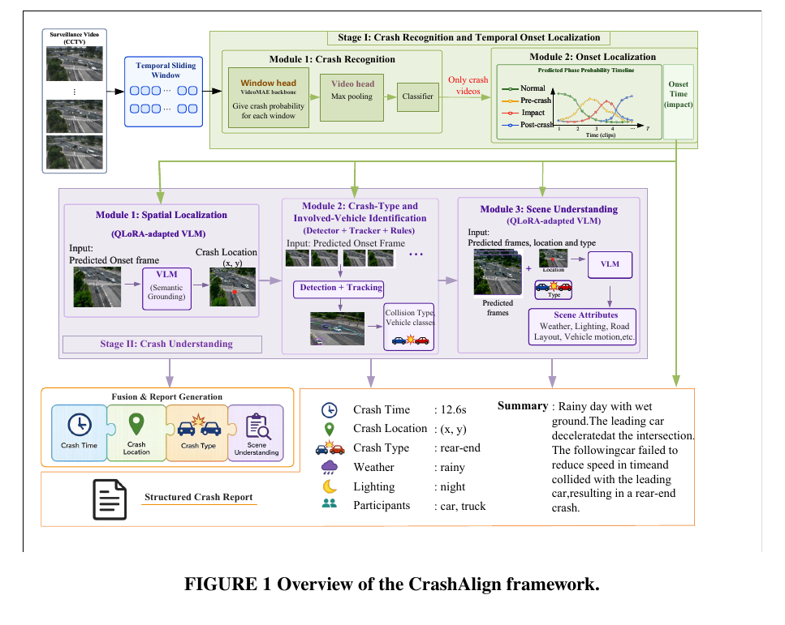
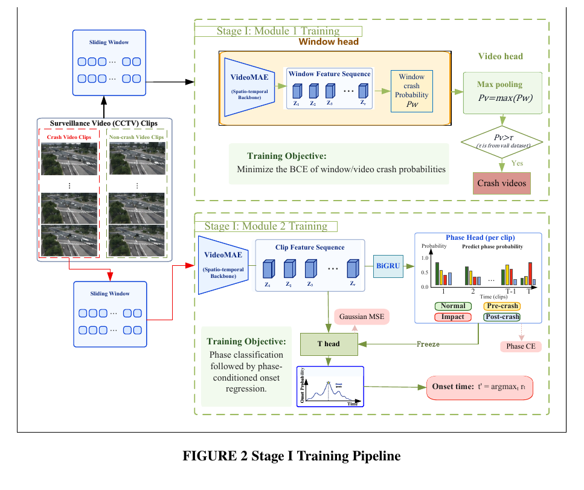
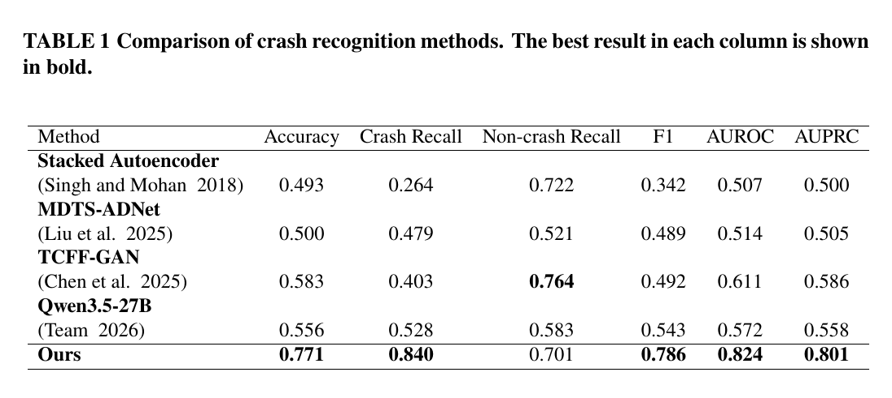
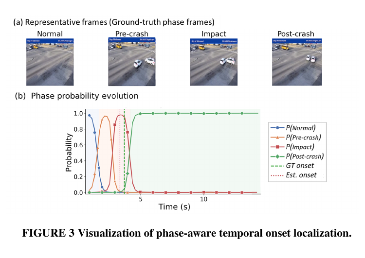
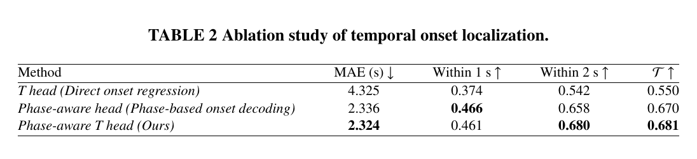
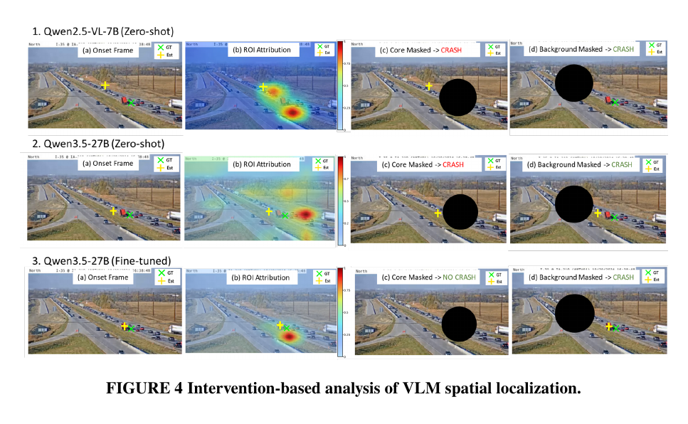
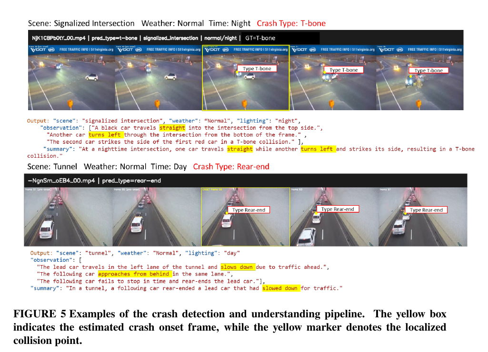
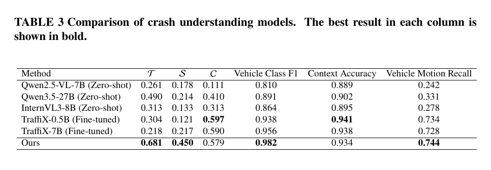
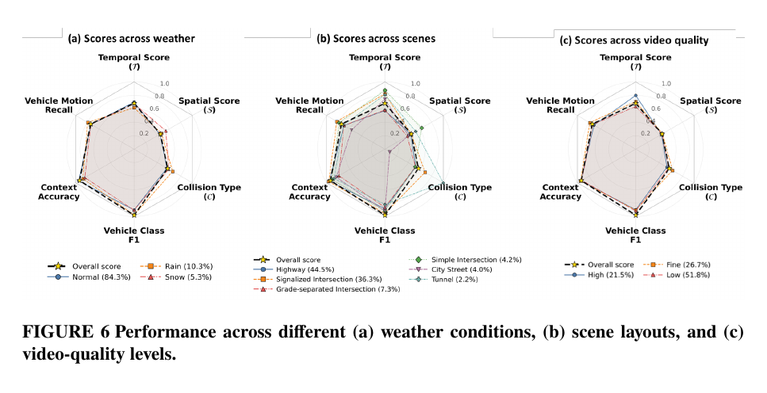

# Paper figures for the README

图和表都从稿件 `2027AAP_specialissue_1027` 裁出，已去掉页眉和正文。写 README 时直接引用 `docs/figures/` 里的文件，图注用下面的英文原文。

Source: manuscript PDF. Crops keep the printed caption and drop the running header.

Suggested README order / 建议在 README 里的顺序:

1. `fig1_overview.png` — 仓库首页，整条流水线
2. `fig2_stage1_training.png` — Stage I 怎么训练
3. `table1_crash_recognition.png` — 识别结果
4. `fig3_phase_onset.png` 和 `table2_onset_ablation.png` — onset
5. `fig4_spatial_intervention.png` — 空间定位
6. `fig5_pipeline_examples.png` — 端到端例子
7. `table3_crash_understanding.png` 和 `fig6_robustness.png` — Stage II 结果和稳健性

---

## Figure 1 — framework

README 开头用这张。它对应五个模块：识别、onset、空间、类型、报告。



```markdown

```

## Figure 2 — Stage I training

Module 1 是窗口头加 max pooling。Module 2 先做四阶段分类，再冻结，用 Gaussian MSE 训练 T head。



```markdown

```

## Table 1 — crash recognition



```markdown

```

## Figure 3 — phase-aware onset



```markdown

```

## Table 2 — onset ablation



```markdown

```

## Figure 4 — spatial localization

微调后的 Qwen3.5-27B 和两个零样本模型的对照。遮住碰撞区域后，微调模型不再判成 crash。



```markdown

```

## Figure 5 — full pipeline examples

黄框是估计的 onset 帧，黄点是碰撞点。上面是夜间 T-bone，下面是隧道追尾。



```markdown

```

## Table 3 — crash understanding



```markdown

```

## Figure 6 — weather, scene, video quality



```markdown

```
